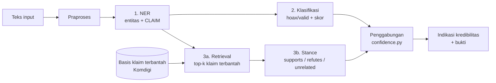

# Architecture

## Alur sistem



- NER selalu jalan pertama; entitasnya dipakai klasifikasi (fitur) dan retrieval (penyempit kandidat).
- Klasifikasi dan retrieval berjalan **paralel**, lalu digabung di `pipeline/confidence.py` ([0010](decisions/0010-klasifikasi-dan-retrieval-paralel.md)). Ini berbeda dari laporan desain awal, yang menjalankan retrieval setelah klasifikasi.
- Basis klaim terbantah adalah data rujukan, bukan model; kemutakhirannya bergantung pada unduhan ulang berkala.

## Aturan penggabungan (draf)

| Klasifikasi | Bukti retrieval + stance | Indikasi |
|---|---|---|
| hoax | ada klaim mirip, stance `supports` | Kredibilitas rendah + bantahan resmi |
| apa pun | ada klaim mirip, stance `refutes` | Input kemungkinan menyangkal hoaks; turunkan kecurigaan |
| hoax / valid | tidak ada klaim mirip | Hanya dari classifier; sampaikan hati-hati |
| skor di bawah ambang | — | Serahkan ke tinjauan manusia |

Ambang keyakinan dipilih di fase 4 (RQ5).

## Kontrak data

Didefinisikan di `src/indonesian_hoax_checker/common/schemas.py`:

| Tipe | Isi |
|---|---|
| `Entity` | `text`, `label` (PER/ORG/LOC/TIME/CLAIM), `start`, `end` (posisi karakter) |
| `NERResult` | `entities`, `core_claim` |
| `ClassificationResult` | `label` (`hoax`/`valid`), `confidence` 0–1 |
| `RetrievalResult` | `matched_claim`, `clarification`, `similarity_score` (None bila tidak ada) |
| `StanceResult` | `label` (`supports`/`refutes`/`unrelated`), `confidence` |

Masih draf. Yang perlu diputuskan: retrieval mengembalikan top-k sedangkan `RetrievalResult` hanya satu, dan `core_claim` untuk input multi-kalimat.

## Modul

| Folder | Isi |
|---|---|
| `preprocessing/` | Normalisasi teks, tokenisasi |
| `data/` | Loader dan konversi dataset mentah |
| `ner/` | BiLSTM-CRF dan IndoBERT token classification |
| `classification/` | TF-IDF + LR dan IndoBERT sequence classification |
| `retrieval/` | Korpus klaim, BM25, embedding, penyaring kandidat berbasis entitas |
| `stance/` | Model NLI dan pemetaan label |
| `pipeline/` | `stages.py` (pembungkus tiap tahap), `orchestrator.py`, `confidence.py` |
| `evaluation/` | Split, metrik bersama, ablasi, error analysis |
| `common/` | Kontrak data |
| `cli.py` | Demo command prompt |

## Model

| Komponen | Baseline | Model kuat |
|---|---|---|
| NER | BiLSTM-CRF | `indobenchmark/indobert-base-p1` (fine-tune) |
| Klasifikasi | TF-IDF + regresi logistik | `indobenchmark/indobert-base-p1` (fine-tune) |
| Retrieval | BM25 | Sentence embedding siap pakai (mis. multilingual-e5), dipilih Danendra |
| Stance | Ambang similarity | Model NLI (fine-tune), base belum dikunci |

Model terlatih disimpan di `artifacts/checkpoints/`, indeks retrieval di `artifacts/retrieval_indexes/`. Demo hanya memuat model, tidak melatih.

## CLI

```bash
python -m indonesian_hoax_checker "teks klaim"
python -m indonesian_hoax_checker --task ner --verbose "teks klaim"
python -m indonesian_hoax_checker            # mode interaktif
```

`--verbose` menampilkan keluaran tiap tahap; `--task` menjalankan satu task saja. Status: argumen sudah ada, pipeline belum dipasang.

## Risiko (dari diagram BEAM)

| Risiko | Muncul di | Kontrol | Metrik |
|---|---|---|---|
| Positif palsu (berita benar dicap hoaks) | Klasifikasi | Audit bias data, ambang + tinjauan manual | FP rate per kelas dan kategori |
| Negatif palsu (hoaks lolos) | Klasifikasi | Bukti retrieval | FN rate |
| Salah stance (arah bukti terbalik) | Stance | Bukti tertelusur | Kebingungan supports vs refutes |
| Basis bantahan usang | Retrieval | Unduh ulang berkala | Recall vs usia klaim |
| Salah ekstraksi entitas | NER | Normalisasi teks informal | F1 per tipe, formal vs informal |
