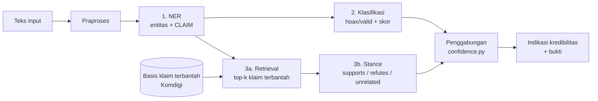

# Architecture

## Alur sistem



- NER selalu jalan pertama; entitasnya dipakai klasifikasi (fitur) dan retrieval (penyempit kandidat).
- Klasifikasi dan retrieval berjalan **paralel**, lalu digabung di `pipeline/confidence.py` ([0010](decisions/0010-klasifikasi-dan-retrieval-paralel.md)). Ini berbeda dari laporan desain awal, yang menjalankan retrieval setelah klasifikasi.
- Basis klaim terbantah adalah data rujukan, bukan model; kemutakhirannya bergantung pada unduhan ulang berkala.

## Aturan penggabungan

| Klasifikasi | Bukti retrieval + stance | Indikasi |
|---|---|---|
| hoax | ada klaim mirip, stance `supports` | Kredibilitas rendah + bantahan resmi |
| apa pun | ada klaim mirip, stance `refutes` | Tinjauan manusia + bantahan resmi (input tampak menyangkal hoaks). Sejak 14 Nov 2026 tidak lagi "kemungkinan benar": 5 dari 8 `refutes` di kasus demo keliru |
| hoax / valid | tidak ada klaim mirip | Hanya dari classifier; sampaikan hati-hati |
| skor di bawah ambang | — | Serahkan ke tinjauan manusia |

Ambang keyakinan dipilih di fase 4 (RQ5).

## Kontrak data

Didefinisikan di `src/indonesian_hoax_checker/common/schemas.py`:

| Tipe | Isi |
|---|---|
| `Entity` | `text`, `label` (PER/ORG/LOC/TIME/CLAIM), `start`, `end` (posisi karakter) |
| `NERResult` | `entities`, `core_claim` (span CLAIM pertama) |
| `ClassificationResult` | `label` (`hoax`/`valid`), `confidence` 0–1 |
| `RetrievalCandidate` | `claim_id`, `claim`, `clarification`, `url`, `published_at`, `score` |
| `RetrievalResult` | `candidates` (top-k terurut, boleh kosong), `scorer` (`bm25`/`embedding`), plus `matched_claim`, `clarification`, `similarity_score` = kandidat pertama atau None |
| `StanceResult` | `label` (`supports`/`refutes`/`unrelated`), `confidence`, `claim_id` klaim terbantah yang dinilai |

Ditinjau Danendra 11 Nov 2026 (disahkan di rapat 13 Nov): retrieval mengembalikan top-k lewat `candidates`, tiga field lama dipertahankan agar laporan tidak berubah; nama field entitas tetap `label`; `core_claim` tetap satu string (NER memilih CLAIM pertama untuk input multi-kalimat, sisanya ada di `entities`), retrieval memakai `core_claim` bila tidak kosong dan teks input bila kosong. Diubah 14 Nov 2026: kueri retrieval dan hypothesis stance sama-sama memakai **teks input penuh** (`orchestrator.retrieval_query` dan `orchestrator.input_claim`; angka pembandingnya ada di komentar fungsi itu). `core_claim` tetap dihasilkan NER dan ditampilkan di CLI.

## Modul

| Folder | Isi |
|---|---|
| `preprocessing/` | Normalisasi teks, tokenisasi |
| `data/` | Loader dan konversi dataset mentah |
| `ner/` | BiLSTM-CRF dan IndoBERT token classification |
| `classification/` | TF-IDF + LR dan IndoBERT sequence classification |
| `retrieval/` | Korpus klaim, BM25, embedding, penyaring kandidat berbasis entitas |
| `stance/` | Model NLI dan pemetaan label |
| `pipeline/` | `stages.py` (pembungkus tiap tahap), `orchestrator.py`, `confidence.py` |
| `evaluation/` | Split, metrik bersama, ablasi, error analysis |
| `common/` | Kontrak data |
| `cli.py` | Demo command prompt |

## Model

| Komponen | Baseline | Model kuat |
|---|---|---|
| NER | BiLSTM-CRF | `indobenchmark/indobert-base-p1` (fine-tune) |
| Klasifikasi | TF-IDF + regresi logistik | `indobenchmark/indobert-base-p1` (fine-tune) |
| Retrieval | BM25 | Sentence embedding siap pakai: `intfloat/multilingual-e5-base` (dipakai di CLI) |
| Stance | Ambang similarity | `indobenchmark/indobert-base-p1` NLI (fine-tune); di CLI dipakai mDeBERTa zero-shot dua arah ([0013](decisions/0013-penyambungan-retrieval-dan-stance-di-pipeline.md)) |

Model terlatih disimpan di `artifacts/checkpoints/`, indeks retrieval di `artifacts/retrieval_indexes/`. Demo hanya memuat model, tidak melatih.

## CLI

```bash
python -m indonesian_hoax_checker "teks klaim"
python -m indonesian_hoax_checker --task ner --verbose "teks klaim"
python -m indonesian_hoax_checker            # mode interaktif
```

`--verbose` menampilkan keluaran tiap tahap; `--task` menjalankan satu task saja. Semua tahap membaca `configs/pipeline.yaml`; tahap yang modelnya belum tersedia berjalan sebagai **stub** dan ditandai `[STUB]`.

| Tahap | Yang harus ada di mesin demo | Asal |
|---|---|---|
| NER | `artifacts/checkpoints/ner/ner_indobert_entity_seed42`, `ner_indobert_claim_seed42` | Drive `hasil_training/ner_20261112-1801/ner_checkpoints_seed42.zip`, lalu zip CLAIM `hasil_training/ner_20261114-1153` (ekstrak berurutan) |
| Klasifikasi | `artifacts/checkpoints/classifier/indobert_seed13` | Drive `hasil_training/indobert_classifier_seed13.zip` (462 MB), ekstrak di root repo. Hasil latih ulang seed 13 khusus demo CLI, bukan sumber angka laporan |
| Retrieval | `data/processed/refuted_claims/claims.jsonl` + model HF `intfloat/multilingual-e5-base` | Klaim: `retrieval.corpus` dari Komdigi; model diunduh otomatis, embedding di-cache di `artifacts/retrieval_indexes/` |
| Stance | model HF `MoritzLaurer/mDeBERTa-v3-base-xnli-multilingual-nli-2mil7` | Diunduh otomatis saat pertama dipakai |

Pemanggilan pertama lambat (unduh model dan embedding basis klaim). Mode interaktif memuat model sekali, jadi pakai itu untuk demo banyak kasus (`data/demo_cases.txt`).

Entitas NER sudah bisa dipakai langsung oleh task lain lewat tahap pipeline:

```python
from indonesian_hoax_checker.pipeline.stages import NERStage

ner = NERStage.from_config()  # checkpoint dari configs/pipeline.yaml
ner("Pemerintah menghentikan bantuan MBG mulai bulan depan")  # -> NERResult
ner.run_batch([...])          # banyak teks sekaligus, lebih cepat
```

Checkpoint diambil dari Drive `hasil_training` (lihat tabel di bagian CLI). Bila `ner.checkpoint: null`, tahap ini berjalan sebagai **stub** (entitas kosong), supaya klasifikasi dan retrieval bisa dikembangkan sebelum model NER tersedia ([0005](decisions/0005-entitas-untuk-task-2-dan-3.md)).

## Risiko (dari diagram BEAM)

| Risiko | Muncul di | Kontrol | Metrik |
|---|---|---|---|
| Positif palsu (berita benar dicap hoaks) | Klasifikasi | Audit bias data, ambang + tinjauan manual | FP rate per kelas dan kategori |
| Negatif palsu (hoaks lolos) | Klasifikasi | Bukti retrieval | FN rate |
| Salah stance (arah bukti terbalik) | Stance | Bukti tertelusur | Kebingungan supports vs refutes |
| Basis bantahan usang | Retrieval | Unduh ulang berkala | Recall vs usia klaim |
| Salah ekstraksi entitas | NER | Normalisasi teks informal | F1 per tipe, formal vs informal |
